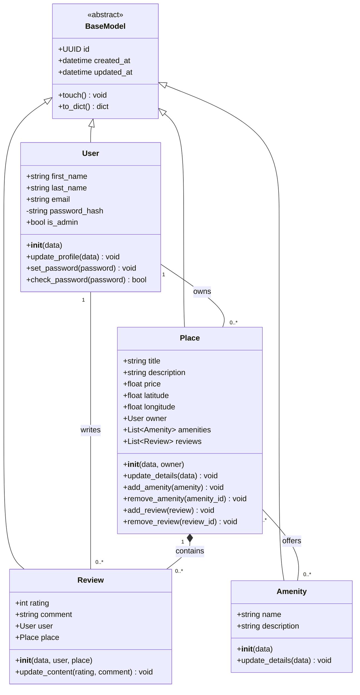

# HBnB Evolution — Detailed Class Diagram

## Purpose

This diagram describes the Business Logic entities: User, Place,
Review, and Amenity. BaseModel provides their shared identity
and audit fields.

## Class Diagram

## Shared Identity and Timestamps

Every entity inherits these attributes from BaseModel:

- id: a unique identifier generated using uuid.uuid4().
- created_at: the UTC date and time of creation.
- updated_at: the UTC date and time of the latest modification.

The ID and created_at remain unchanged throughout the object's lifetime.
Every modification calls touch() to refresh updated_at.

BaseModel is an abstract design element. Domain objects are instances
of its concrete subclasses.

## Entity Responsibilities

### User

Represents a registered user.

- first_name and last_name identify the user.
- email stores the user's email address.
- password_hash stores the hash of the supplied password.
- is_admin identifies administrators and defaults to false.
- update_profile() updates permitted profile fields.
- set_password() hashes a new password.
- check_password() verifies a supplied password.

The constructor accepts the password required by the project and stores
its hash. to_dict() excludes password_hash from serialized output.

### Place

Represents a property listed by its owner.

- Stores title, description, price, latitude, and longitude.
- Has exactly one User as its owner.
- Can have multiple amenities and reviews.
- update_details() changes property information.
- add_amenity() and remove_amenity() manage amenity associations.
- add_review() and remove_review() manage its reviews.

### Review

Represents a rating and comment submitted by a user about a place.

- Has exactly one author and one associated place.
- Stores rating and comment.
- update_content() changes the rating or comment.

### Amenity

Represents a named feature that can be associated with places.

- Stores name and description.
- Can be shared by multiple places.
- update_details() changes its descriptive information.

Constructors and update methods validate their input.
Model-specific updates modify only permitted fields and refresh updated_at.

## Relationships and Multiplicities

| Relationship | Type | Meaning |
| --- | --- | --- |
| BaseModel and its subclasses | Generalization | All four entities inherit IDs and timestamps. |
| User and Place | One-to-many association | Each Place has one owner; a User can own zero or many places. |
| User and Review | One-to-many association | Each Review has one author; a User can write zero or many reviews. |
| Place and Review | One-to-many composition | Each Review belongs to one Place and follows the lifetime policy below. |
| Place and Amenity | Many-to-many association | Places can offer multiple amenities; amenities can be shared by multiple places. |

## Application Operations Through HBnBFacade

HBnBFacade coordinates model behavior and repository operations.
The following proposed methods support the required lifecycle operations:

| Entity | Facade operations |
| --- | --- |
| User | register_user(data), get_user(user_id), update_user(user_id, data), delete_user(user_id) |
| Place | create_place(owner_id, data), get_place(place_id), update_place(place_id, data), delete_place(place_id), list_places(filters) |
| Review | create_review(user_id, place_id, data), update_review(review_id, data), delete_review(review_id), list_reviews(place_id) |
| Amenity | create_amenity(data), update_amenity(amenity_id, data), delete_amenity(amenity_id), list_amenities() |

Models validate their state and relationships.
The facade coordinates creation and deletion.
Repositories perform data storage and retrieval.

## Proposed Deletion Policy

The project requires deletion operations but does not specify every
cascade rule. This design adopts the following policy:

- Deleting a Place deletes its associated Reviews. This lifetime
  dependency is represented by composition.
- Deleting a Place removes its amenity links while preserving
  the shared Amenity objects.
- Deleting an Amenity removes its links while preserving the Places.
- Deleting a User is coordinated by the facade: remove their authored
  reviews and owned places, apply the Place-Review cascade, and then
  remove the user. This prevents orphan references.

These are explicit design decisions to confirm during the manual review.

## UML Notation

- A hollow triangle points toward the superclass.
- A filled diamond marks the whole in a composition relationship.
- Plain lines represent associations.
- 1 means exactly one.
- 0..* means zero or more.
- + indicates public visibility.
- - indicates private visibility.
