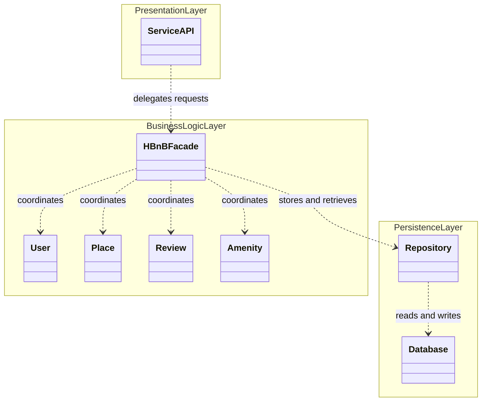

# HBnB Evolution — High-Level Package Diagram

## Purpose

This document describes the three-layer architecture of HBnB Evolution
and the communication between its packages through the facade pattern.

## Architecture diagram

The namespaces represent architectural packages.
Dashed arrows represent dependencies and point toward the component used.

## Presentation Layer

The Presentation Layer contains the services and API endpoints through
which clients interact with the application.

It receives HTTP requests, reads input, delegates application operations
to HBnBFacade, and builds HTTP responses with appropriate status codes.

Its endpoints cover users, places, reviews, and amenities.

## Business Logic Layer

The Business Logic Layer contains HBnBFacade and the domain models:

- User: profiles, credentials, and administrator status.
- Place: property details, ownership, location, price, and amenities.
- Review: ratings and comments associated with users and places.
- Amenity: named features that can be associated with places.

This layer coordinates application operations and enforces business rules.

All domain entities have a unique ID and creation and update timestamps.

## Persistence Layer

The Persistence Layer stores, retrieves, updates, and deletes entity data.

Repositories encapsulate database access and provide storage operations
to the Business Logic Layer.

The database technology and concrete repository implementations will be
defined in later project parts.

## Facade Pattern

HBnBFacade belongs to the Business Logic Layer and provides a unified
entry point for the Presentation Layer.

The API calls facade operations for use cases such as registering users,
creating places, submitting reviews, and listing places.

The facade coordinates the relevant models and calls repositories when
data must be stored or retrieved.

This organization keeps HTTP handling, business rules, and database
access in their respective layers.

## Example: Creating a Place

1. ServiceAPI receives the request and passes its data to HBnBFacade.
2. HBnBFacade coordinates the Place and User models to validate the data
   and identify the owner.
3. The facade asks the repository to save the place.
4. The repository stores the data in the database and returns the result.
5. The facade returns the operation result to ServiceAPI.
6. ServiceAPI sends the HTTP response to the client.

## Diagram Scope

This diagram describes packages, responsibilities, and dependencies.
Detailed model attributes, methods, and relationships will be documented
in the class diagram.
