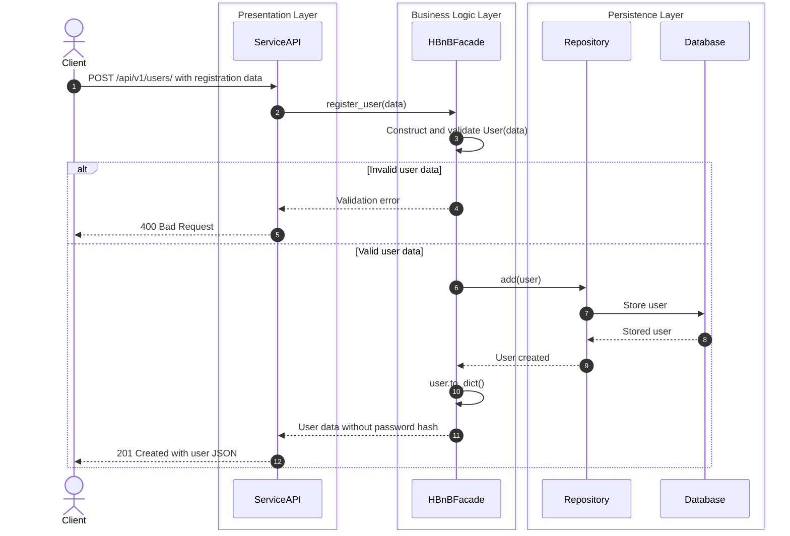
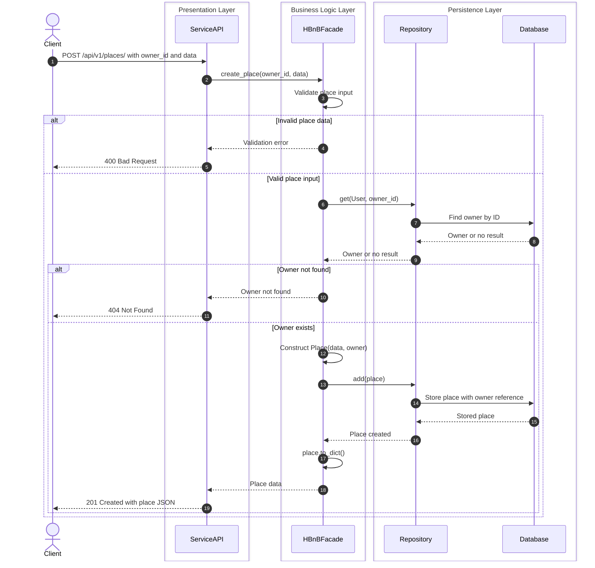
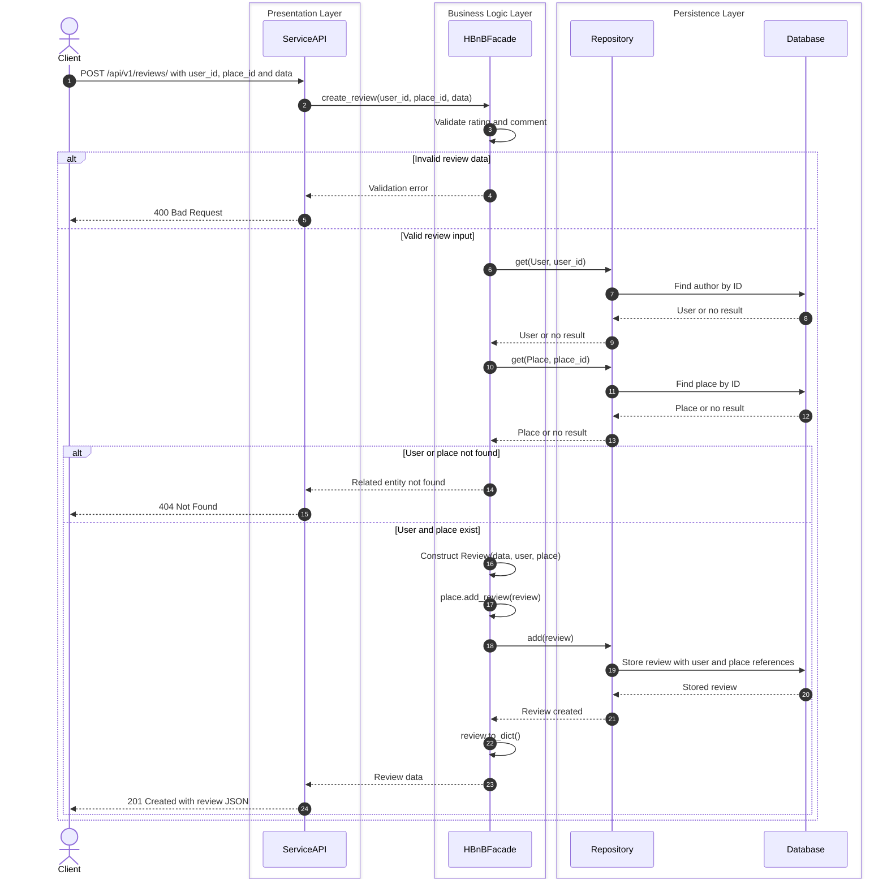
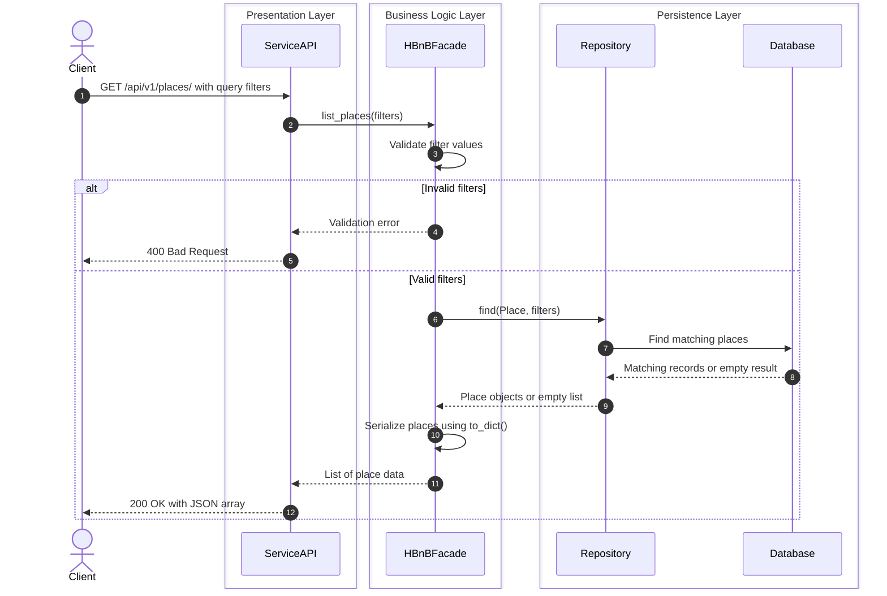

# HBnB Evolution — Sequence Diagrams for API Calls

## Purpose

These diagrams describe four API calls and their interactions across
the Presentation, Business Logic, and Persistence layers.

## Participants

| Participant | Responsibility |
| --- | --- |
| Client | Sends HTTP requests and receives responses. |
| ServiceAPI | Presentation Layer: reads request data, calls the facade, and builds HTTP responses. |
| HBnBFacade | Business Logic Layer: coordinates use cases and domain models. |
| Repository | Persistence Layer: encapsulates storage access. |
| Database | Persistence Layer: stores and retrieves entity data. |

Facade self-messages summarize its internal coordination of the
domain models. Models validate their own state.

The API paths and repository method names below are proposed interfaces.

## 1. User Registration

The client supplies registration data. The facade coordinates User
construction, input validation, password hashing, and persistence.

### Notes

- The constructor initializes a UUID4, created_at, and updated_at.
- The supplied password is stored as a hash.
- Public user data excludes password_hash.
- Invalid data returns 400 without storing the user.
- Successful registration returns 201.

## 2. Place Creation

The client provides property data and an owner ID. The facade validates
the input and retrieves the owner before constructing the Place.

### Notes

- Place data includes title, description, price, latitude, and longitude.
- Each Place must reference exactly one existing owner.
- Construction initializes its UUID4 and audit timestamps.
- Invalid input returns 400.
- A missing owner returns 404.
- Successful creation returns 201.
- This example creates a place without initial amenities.
  Later associations use add_amenity().

## 3. Review Submission

The client supplies a user ID, place ID, rating, and comment.
The facade validates the input and retrieves the related entities.

### Notes

- Each Review has exactly one author and one associated Place.
- Construction initializes its UUID4 and audit timestamps.
- place.add_review(review) maintains the domain relationship.
- Persistence stores the review and its user and place references.
- Invalid review data returns 400.
- A missing user or place returns 404.
- Successful submission returns 201.

## 4. Fetching a List of Places

The client supplies optional search criteria through query parameters.
The facade validates the filters and retrieves matching places.

### Notes

- The repository applies the validated search criteria.
- Matching places are serialized into a JSON array.
- A valid query with no matches returns [] with status 200.
- Invalid filters return 400.
- Reading places preserves their IDs and timestamps.

## Architecture Consistency

- ServiceAPI delegates application operations to HBnBFacade.
- The facade coordinates domain behavior and repository operations.
- Repositories encapsulate database access.
- Results return through the facade to the API.
- Persistence messages are conceptual. Database technology will be
  selected in a later project part.

## Response Summary

| API call | Success | Error paths shown |
| --- | --- | --- |
| User registration | 201 with public user data | 400 for invalid data |
| Place creation | 201 with place data | 400 for invalid data; 404 for a missing owner |
| Review submission | 201 with review data | 400 for invalid data; 404 for a missing user or place |
| Place listing | 200 with an array | 400 for invalid filters |
